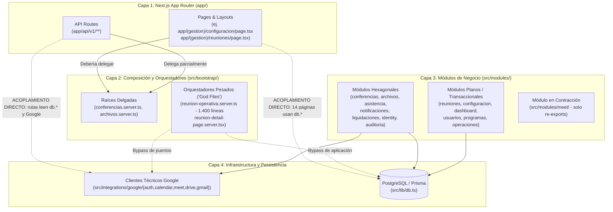

# Diagnóstico Exhaustivo de Arquitectura, Acoplamiento y Coherencia (`flacso-meet`)

> **Fecha de auditoría:** 17 de octubre de 2026  
> **Repositorio:** `salavirtual-flacsouruguay` (`flacso-meet`)  
> **Alcance:** Análisis integral de acoplamiento estructural, coherencia de estado, modelo relacional (`prisma/schema.prisma`), integración con Google Workspace (Calendar, Meet v2, Drive, Admin Reports), capa de presentación y plan de consolidación.

---

## 1. Resumen Ejecutivo

La plataforma **Sala Virtual FLACSO Uruguay** evolucionó rápidamente desde una herramienta de reservas y migración histórica de Zoom hacia un sistema integral de **aprovisionamiento automatizado de Google Meet, gestión de asistencia técnica, liquidación de horas, sincronización de grabaciones en Drive y consola de operación en tiempo real**.

Durante esa evolución, el plan de migración hacia un monolito modular hexagonal (`docs/superpowers/plans/2026-09-19-capas-y-encapsulamiento-plan-rector.md`) quedó ejecutado de forma **parcial (~45% de los módulos)**, mientras que las nuevas funcionalidades operativas se construyeron directamente sobre `src/bootstrap/`, `app/` y servicios transaccionales planos. Esto produjo **cuatro síntomas estructurales principales**:

1. **Coexistencia de 4 patrones arquitectónicos distintos en el mismo repositorio** (módulos hexagonales puros, módulos planos acoplados a Prisma, "God Orchestrators" en `src/bootstrap/` y páginas/rutas en `app/` con consultas SQL/Prisma directas).
2. **Fragmentación de reglas de negocio críticas en múltiples lugares** (por ejemplo, la lógica de credenciales `ConfiguracionGoogleWorkspace` se consulta directamente en **18 archivos**, y la sincronización/verificación de cohosts de Google Meet tiene **5 implementaciones paralelas**).
3. **Acoplamiento de estado y violaciones de 3NF en el modelo de datos** (identidad de serie implícita por `{ docenteProgramaId, titulo, createdAt }`, doble tabla de cohosts `CohostReunion` + `CohostEmailReunion`, y sobrecarga del campo JSON `EventoProveedor.payloadUltimo` mezclando el payload crudo de Google Calendar con metadatos internos de `salaVirtual`).
4. **Colisiones y duplicación en la capa de presentación** (22 hojas CSS globales importadas en `app/(gestion)/layout.tsx` y componentes duplicados como `PendingMeetButton` + `PendingMeetOperationsManager`).

---

## 2. Mapa de la Arquitectura Real vs. Arquitectura Objetivo



### 2.1 Clasificación actual de los módulos en `src/modules/`

| Módulo | Estado Arquitectónico | Capas Presentes | Problemas de Acoplamiento Detectados |
| :--- | :--- | :--- | :--- |
| `conferencias` | **Hexagonal Completo** | `domain`, `ports`, `application`, `infrastructure`, `api.ts` | Su adaptador `google-conference-provider.adapter.ts` importa `db` directamente para idempotencia (`ejecutarGooglePostUnaVez`) y credenciales `legacy:*`. |
| `archivos` | **Hexagonal Completo** | `domain`, `ports`, `application`, `infrastructure`, `api.ts` | Limpio, aunque `reunion-operativa.server.ts` instancia `crearGoogleArtifactsProviderAdapter` directamente saltándose el repositorio del módulo. |
| `notificaciones` | **Hexagonal Completo** | `domain`, `ports`, `application`, `infrastructure`, `api.ts` | Coexiste con el archivo heredado `src/modules/notificaciones/notificaciones.service.ts` aún usado por `asistencia.service.ts`. |
| `liquidaciones` | **Hexagonal Completo** | `domain`, `ports`, `application`, `infrastructure`, `api.ts` | Bien encapsulado tras `src/bootstrap/liquidaciones.server.ts`. |
| `identity` | **Hexagonal Completo** | `domain`, `ports`, `application`, `infrastructure`, `api.ts` | Coexiste con `src/modules/usuarios/*` sin frontera clara entre identidad de autenticación y gestión de usuarios. |
| `auditoria` | **Hexagonal Completo** | `domain`, `ports`, `application`, `infrastructure`, `api.ts` | Muchos servicios siguen escribiendo `tx.auditoria.create(...)` manualmente en lugar de usar el módulo. |
| `asistencia` | **Híbrido Incompleto** | `domain`, `ports`, `application`, `infrastructure`, `presentation` + servicios planos | Duplicación crítica: `src/modules/asistencia/asistencia.service.ts` (672 líneas) coexiste con `src/modules/asistencia/application/*.use-case.ts`. |
| `reuniones` | **Plano / Acoplado** | `*.domain.ts`, `*.service.ts`, `*.adapter.ts`, `presentation/` | Sin `ports/` ni `application/`. Los servicios reciben `PrismaClient` directamente y orquestan transacciones, bloqueos `pg_advisory_xact_lock` y llamadas a Google. |
| `configuracion` | **Plano / Acoplado** | `*.domain.ts`, `*.service.ts`, `*.adapter.ts` | Contiene lógica de conferencias (`resincronizar-cohosts.service.ts`, `verificar-cohosts-global.service.ts`) que pertenece al dominio de `conferencias`. |
| `dashboard` | **Plano / Acoplado** | `*.domain.ts`, `*.adapter.ts`, `types.ts` | Consultas Prisma masivas por rol con lógica de presentación embebida. |
| `usuarios`, `programas`, `salas`, `operaciones`, `historico` | **Planos** | `*.domain.ts`, `*.service.ts` | Servicios transaccionales directos sobre `PrismaClient`. |

---

## 3. Hallazgos Críticos de Acoplamiento y Coherencia

### 3.1 Dispersión de Credenciales y Delegación de Google Workspace (18 Puntos de Lectura)

La tabla `ConfiguracionGoogleWorkspace` almacena la credencial `principal` y las credenciales históricas `legacy:<email>`. En lugar de existir un único puerto/proveedor (`WorkspaceCredentialsPort`), **18 archivos distintos** ejecutan `db.configuracionGoogleWorkspace.findUnique({ where: { id: "principal" } })` y descifran `privateKeyCifrada`:

- **Inconsistencia en el filtro `activa: true`:** Algunos puntos consultan `{ where: { id: "principal", activa: true } }` (`prisma-conferencias-repository.adapter.ts`, `reunion-operativa.server.ts`) mientras que otros consultan `{ where: { id: "principal" } }` sin verificar si la integración está pausada (`app/(gestion)/grabaciones/page.tsx`, `app/api/v1/reuniones/instancias/[instanciaId]/correos-asistencia/route.ts`).
- **Inconsistencia en el sujeto delegado (`subject`):**
  - Para **Calendar y Meet Spaces**, el `subject` debe ser obligatoriamente el `emailOrganizador` de la sala (`sala01@flacso.edu.uy`, `salameet1@flacso.edu.uy`, etc.).
  - Para **Admin Reports API** (`obtenerEventosAuditoriaMeet`), el `subject` requiere una cuenta con privilegios de administrador (`GOOGLE_REPORTS_ADMIN_EMAIL` o `serviceAccountSubject`).
  - Para **Drive**, algunas operaciones usan `serviceAccountSubject` y otras el `emailOrganizador` de la sala.
- **Inconsistencia en el fallback `Principal -> Legacy`:**
  - Hasta la corrección aplicada en esta revisión, `isMemberPermissionError` (`src/integrations/google/meet/meet-spaces.client.ts`) solo buscaba el texto en inglés `"permission denied"` + `"resource member"`. Como las cuentas organizadoras de FLACSO tienen idioma español configurado en Google, la API de Google Meet devuelve `"No tenés permisos para modificar el rol de este miembro."`. Al no coincidir el texto en inglés, **el fallback hacia credenciales Legacy nunca se disparaba en producción** cuando Google respondía en español.

### 3.2 Cinco Flujos Paralelos para Sincronizar y Verificar Cohosts en Google Meet

La gestión de co-anfitriones (`COHOST`) en Google Meet está repartida en 5 flujos independientes:

1. **Aprovisionamiento y cola de pendientes** (`sincronizarEventosPendientesUseCase` $\rightarrow$ `google-conference-provider.adapter.ts`):
   - Ejecuta `configurarEspacioMeet` + `configurarCohostsMeet`.
2. **Edición de serie** (`src/modules/reuniones/gestionar-cohosts-serie.service.ts`):
   - Invalida `payloadUltimo` en la base de datos *antes* de llamar a Google y fuera de la transacción final, luego llama a `sincronizarCohostsGoogleExistente` y finalmente reemplaza `CohostReunion` y `CohostEmailReunion`.
3. **Asignación/desvinculación de Asistente Técnico** (`sincronizarCohostsDeInstancia` en `asistencia.service.ts` **y** `sincronizarCohostsDeInstanciaUseCase` en `src/modules/asistencia/application/sincronizar-cohosts-asistencia.use-case.ts`):
   - Dos implementaciones casi idénticas dentro del mismo módulo `asistencia`.
4. **Resincronización masiva desde Configuración** (`src/modules/configuracion/resincronizar-cohosts.service.ts`):
   - Recalcula cohosts automáticos (docente + AT) e invoca `sincronizarEventosPendientesUseCase`.
5. **Verificación de cohosts** (`src/modules/configuracion/verificar-cohosts-global.service.ts` vs. `app/api/v1/reuniones/[solicitudId]/cohosts/verificar/route.ts`):
   - Ambos implementan por separado la iteración `Principal -> Legacy` llamando a `obtenerEspacioMeet` y `listarMiembrosMeetHttp`.

### 3.3 Limitación Técnica de `spaces.members` en Google Meet API v2 y Promoción de Miembros

Cuando Google Calendar crea o actualiza un evento con invitados (`attendees`), Google vincula automáticamente esos correos en el espacio de Meet como miembros con `role: "ROLE_UNSPECIFIED"`.
- Al intentar asignarlos como co-anfitriones mediante `POST /v2/spaces/{space}/members` (`crearMiembroMeetHttp`), Google Meet devuelve `409 ALREADY_EXISTS`.
- En el commit `167d486` se reemplazó la recreación (`DELETE` + `POST`) por `PATCH /v2/{member.name}?updateMask=role` (`actualizarRolMiembroMeetHttp`). Sin embargo, la API v2 de Google Meet en producción rechaza `PATCH` sobre miembros creados por Calendar con `403: No tenés permisos para modificar el rol de este miembro.` (tal como documentaba originalmente `docs/configuracion-google-workspace.md`: *"Si un miembro existe con otro rol, se recrea con `COHOST` porque la API de miembros no ofrece una operación de actualización"*).
- **Solución implementada:** En `configurarCohostsMeet` (`src/modules/conferencias/infrastructure/google/google-conference-provider.adapter.ts`), si `actualizarRolMiembroMeetHttp` (`PATCH`) falla por permisos (`403`) o método no soportado (`400`/`404`/`405`), el adaptador ejecuta automáticamente el fallback seguro `DELETE` (`eliminarMiembroMeetHttp`) + `POST` (`crearMiembroMeetHttp` con `role: "COHOST"`), procesando además todos los cohosts deseados antes de propagar cualquier error de permiso individual para que un único correo restringido no impida promover al resto de los cohosts de la reunión.

### 3.4 Acoplamiento en el Modelo de Datos (`prisma/schema.prisma`)

1. **Agrupación implícita de series por coincidencia de campos:**
   - Aunque existe el modelo `SerieReunion` en `prisma/schema.prisma`, las consultas de serie en `reunion-detail-page.server.tsx`, `gestionar-cohosts-serie.service.ts`, `prisma-conferencias-repository.adapter.ts` y `cohosts/verificar/route.ts` agrupan solicitudes buscando:
     ```ts
     where: {
       docenteProgramaId: request.docenteProgramaId,
       titulo: request.titulo,
       createdAt: request.createdAt
     }
     ```
   - Esto acopla la identidad de una serie a que el título y el `createdAt` coincidan al milisegundo entre filas de `SolicitudSala`.
2. **Bifurcación de Cohosts (`CohostReunion` vs. `CohostEmailReunion`):**
   - Los cohosts con cuenta registrada en `CuentaGoogleFlacso` se guardan en `CohostReunion`, y los correos adicionales en `CohostEmailReunion`. Esto obliga a más de 25 consultas en toda la app a hacer `include: { cohosts: { include: { cuentaGoogle: true } }, cohostEmails: true }` y normalizar ambas listas manualmente.
3. **Columna JSON Polimórfica `EventoProveedor.payloadUltimo`:**
   - Se utiliza simultáneamente como:
     - Cache del recurso `Event` de Google Calendar (`id`, `attendees`, `conferenceData`, `start`, `end`).
     - Almacén de correos invitados (`payloadUltimo.salaVirtual.invitadosEmails`).
     - Almacén del estado de verificación de cohosts (`payloadUltimo.salaVirtual.cohostsVerificados`).
   - Cualquier escritura directa de `payloadUltimo` con la respuesta cruda de Google Calendar sin pasar por `registrarVerificacionCohosts` o sin preservar `salaVirtual` borra silenciosamente los metadatos locales.

### 3.5 Capa de Presentación y Centro de Configuración (`/configuracion?seccion=workspace`)

1. **Duplicación del panel de operaciones pendientes (Corregido):**
   - En `app/(gestion)/configuracion/page.tsx` se renderizaban simultáneamente `<PendingMeetButton />` y `<PendingMeetOperationsManager />` dentro de `.settings-workspace-health`, mostrando dos bloques idénticos de `"1 operación pendiente con Google"` uno encima del otro. Se eliminó `<PendingMeetButton />` de la página dejando únicamente `<PendingMeetOperationsManager />`.
2. **Diagnóstico opaco para errores de `spaces.members` (Corregido):**
   - `PendingMeetOperationsManager` (`src/components/pending-meet-operations-manager.tsx`) solo humanizaba errores de `insufficient authentication scopes`, mostrando en crudo `"Diagnóstico: No tenés permisos para modificar el rol de este miembro."` y ocultando la tarjeta de la reunión colapsada por defecto.
   - Ahora auto-expande la lista cuando hay $\le 5$ encuentros afectados, explica con precisión la causa técnica en español y permite reintentar (con recreación `DELETE+POST` y fallback `Legacy`) o descartar el ajuste no bloqueante sabiendo que el enlace Meet está operativo.
3. **Fragmentación de estilos globales:**
   - `app/(gestion)/layout.tsx` importa 22 archivos CSS globales sin aislamiento por módulo (CSS Modules o prefijos de bloque estrictos), lo que exige alta especificidad al modificar vistas como `/configuracion` o `/operacion/[instanciaId]`.

---

## 4. Correcciones Aplicadas en esta Iteración

| Archivo Modificado | Problema Resuelto |
| :--- | :--- |
| [`app/(gestion)/configuracion/page.tsx`](file:///c:/Users/Iv%C3%A1n/Documents/Migracion-Ubuntu-20261010/repositorios/FLACSO%20Uruguay/flacso-meet/app/%28gestion%29/configuracion/page.tsx) | Eliminada la duplicación visual de `<PendingMeetButton />` sobre `<PendingMeetOperationsManager />` en `/configuracion?seccion=workspace`. |
| [`src/integrations/google/meet/meet-spaces.client.ts`](file:///c:/Users/Iv%C3%A1n/Documents/Migracion-Ubuntu-20261010/repositorios/FLACSO%20Uruguay/flacso-meet/src/integrations/google/meet/meet-spaces.client.ts) | Actualizado `isMemberPermissionError` para detectar mensajes de error de Google Meet localizados al español (`"No tenés permisos para modificar el rol de este miembro."`, `"miembro"` + `"permiso"`/`"rol"`) además de inglés (`"permission denied"` + `"resource member"`). |
| [`src/modules/conferencias/infrastructure/google/google-conference-provider.adapter.ts`](file:///c:/Users/Iv%C3%A1n/Documents/Migracion-Ubuntu-20261010/repositorios/FLACSO%20Uruguay/flacso-meet/src/modules/conferencias/infrastructure/google/google-conference-provider.adapter.ts) | En `configurarCohostsMeet`: cuando `PATCH` (`actualizarRolMiembroMeetHttp`) es rechazado por Google Meet (`403`/`400`/`405`), se aplica fallback automático a `DELETE` + `POST` (`eliminarMiembroMeetHttp` + `crearMiembroMeetHttp` con `COHOST`). Además, se procesan todos los cohosts de la lista antes de propagar un fallo individual de permisos. |
| [`src/modules/conferencias/domain/conferencia-health.domain.ts`](file:///c:/Users/Iv%C3%A1n/Documents/Migracion-Ubuntu-20261010/repositorios/FLACSO%20Uruguay/flacso-meet/src/modules/conferencias/domain/conferencia-health.domain.ts) | Agregado predicado puro `esErrorDePermisoMiembroMeet` al dominio de salud de conferencias. |
| [`src/components/pending-meet-operations-manager.tsx`](file:///c:/Users/Iv%C3%A1n/Documents/Migracion-Ubuntu-20261010/repositorios/FLACSO%20Uruguay/flacso-meet/src/components/pending-meet-operations-manager.tsx) | Añadido diagnóstico específico para restricciones de `spaces.members`, banner explicativo no bloqueante y apertura automática del detalle cuando existen $\le 5$ operaciones pendientes. |
| [`src/bootstrap/reunion-operativa.server.ts`](file:///c:/Users/Iv%C3%A1n/Documents/Migracion-Ubuntu-20261010/repositorios/FLACSO%20Uruguay/flacso-meet/src/bootstrap/reunion-operativa.server.ts) | En `actualizarControlOperativoReunion`: agregado fallback `Principal -> Legacy` al cambiar `tipoAccesoMeet` (`OPEN`/`TRUSTED`/`RESTRICTED`) en espacios históricos y evitado marcar `CONFIGURAR_MEET` pendiente cuando solo se modifican campos locales o de acceso sin cambio de cohosts. |
| [`test/architecture-boundaries.test.ts`](file:///c:/Users/Iv%C3%A1n/Documents/Migracion-Ubuntu-20261010/repositorios/FLACSO%20Uruguay/flacso-meet/test/architecture-boundaries.test.ts) | Corregida la normalización de separadores de ruta en Windows (`replaceAll("\\", "/")`) que impedía evaluar las 4 reglas de aislamiento de capas (`domain`, `ports`, `application`, `presentation`), pasando de ~240 a 420 aserciones activas. |
| [`test/no-meet-runtime-imports.test.ts`](file:///c:/Users/Iv%C3%A1n/Documents/Migracion-Ubuntu-20261010/repositorios/FLACSO%20Uruguay/flacso-meet/test/no-meet-runtime-imports.test.ts) y 9 archivos en `src/modules/` | Migrados los 16 imports relativos residuales `../meet/*` en `src/modules/{asistencia,dashboard,reuniones}` hacia `@/src/modules/conferencias/api` y blindada la prueba de fronteras para cubrir también `src/modules/`. |
| [`src/modules/configuracion/api.ts`](file:///c:/Users/Iv%C3%A1n/Documents/Migracion-Ubuntu-20261010/repositorios/FLACSO%20Uruguay/flacso-meet/src/modules/configuracion/api.ts) | Creada la API pública canónica del módulo `configuracion`, exponiendo servicios de resolución de credenciales con descifrado transparente y fallback a Legacy. |
| [`src/modules/configuracion/google-workspace.service.ts`](file:///c:/Users/Iv%C3%A1n/Documents/Migracion-Ubuntu-20261010/repositorios/FLACSO%20Uruguay/flacso-meet/src/modules/configuracion/google-workspace.service.ts) | Implementados los métodos canónicos `obtenerCredencialWorkspacePorId`, `obtenerCredencialPrincipalGoogleWorkspace`, `obtenerCredencialGoogleParaSala`, `obtenerCredencialAdminReportsGoogle`, `cargarCredencialesLegacyGoogleWorkspace`, `obtenerCredencialesWorkspaceActivas`, `obtenerCandidatosCredencialesParaOrganizador`, `obtenerEstadoConfiguracionAdmin` y `desactivarCredencialLegacyWorkspace`. |
| 17 consumidores en `src/modules/`, `app/` y `scripts/` | Migradas todas las consultas directas `db.configuracionGoogleWorkspace.findUnique` hacia la API canónica de credenciales de Workspace. |
| [`src/modules/conferencias/infrastructure/google/google-conference-provider.adapter.ts`](file:///c:/Users/Iv%C3%A1n/Documents/Migracion-Ubuntu-20261010/repositorios/FLACSO%20Uruguay/flacso-meet/src/modules/conferencias/infrastructure/google/google-conference-provider.adapter.ts) y [`src/modules/conferencias/api.ts`](file:///c:/Users/Iv%C3%A1n/Documents/Migracion-Ubuntu-20261010/repositorios/FLACSO%20Uruguay/flacso-meet/src/modules/conferencias/api.ts) | Unificada la verificación de miembros de Google Meet (`consultarCohostsEspacioMeet`) con fallback `Principal -> Legacy` en el adaptador de conferencias y reexportada canónicamente. |
| [`app/api/v1/reuniones/[solicitudId]/cohosts/verificar/route.ts`](file:///c:/Users/Iv%C3%A1n/Documents/Migracion-Ubuntu-20261010/repositorios/FLACSO%20Uruguay/flacso-meet/app/api/v1/reuniones/%5BsolicitudId%5D/cohosts/verificar/route.ts) y [`src/modules/configuracion/verificar-cohosts-global.service.ts`](file:///c:/Users/Iv%C3%A1n/Documents/Migracion-Ubuntu-20261010/repositorios/FLACSO%20Uruguay/flacso-meet/src/modules/configuracion/verificar-cohosts-global.service.ts) | Delegada la verificación de cohosts exclusivamente a `consultarCohostsEspacioMeet` y `obtenerCredencialesWorkspaceActivas`, eliminando llamadas HTTP crudas acopladas a Google Meet. |
| [`src/modules/reuniones/reunion-operativa.service.ts`](file:///c:/Users/Iv%C3%A1n/Documents/Migracion-Ubuntu-20261010/repositorios/FLACSO%20Uruguay/flacso-meet/src/modules/reuniones/reunion-operativa.service.ts) y [`src/bootstrap/reunion-operativa.server.ts`](file:///c:/Users/Iv%C3%A1n/Documents/Migracion-Ubuntu-20261010/repositorios/FLACSO%20Uruguay/flacso-meet/src/bootstrap/reunion-operativa.server.ts) | Adelgazado `src/bootstrap/reunion-operativa.server.ts` de 1.392 líneas a una fachada canónica de 17 líneas, reubicando toda la lógica de negocio y reconciliación operativa en el módulo `reuniones`. |
| [`src/modules/configuracion/configuracion-page.service.ts`](file:///c:/Users/Iv%C3%A1n/Documents/Migracion-Ubuntu-20261010/repositorios/FLACSO%20Uruguay/flacso-meet/src/modules/configuracion/configuracion-page.service.ts) y [`app/(gestion)/configuracion/page.tsx`](file:///c:/Users/Iv%C3%A1n/Documents/Migracion-Ubuntu-20261010/repositorios/FLACSO%20Uruguay/flacso-meet/app/%28gestion%29/configuracion/page.tsx) | Extraídas 165 líneas de consultas Prisma directas y transformación de operaciones pendientes desde el componente de UI hacia un servicio dedicado en `configuracion`. |
| [`src/modules/reuniones/reuniones-page.service.ts`](file:///c:/Users/Iv%C3%A1n/Documents/Migracion-Ubuntu-20261010/repositorios/FLACSO%20Uruguay/flacso-meet/src/modules/reuniones/reuniones-page.service.ts) y [`app/(gestion)/reuniones/page.tsx`](file:///c:/Users/Iv%C3%A1n/Documents/Migracion-Ubuntu-20261010/repositorios/FLACSO%20Uruguay/flacso-meet/app/%28gestion%29/reuniones/page.tsx) | Extraídas ~370 líneas de armado de filtros temporales/búsquedas y consultas Prisma hacia `reuniones-page.service.ts`, eliminando la importación de `@prisma/client` en la capa de presentación. |
| [`src/modules/asistencia/asistencia.service.ts`](file:///c:/Users/Iv%C3%A1n/Documents/Migracion-Ubuntu-20261010/repositorios/FLACSO%20Uruguay/flacso-meet/src/modules/asistencia/asistencia.service.ts) | Redirigida la sincronización de cohosts de asistencia técnica (`sincronizarCohostsDeInstancia`) hacia `sincronizarCohostsDeInstanciaUseCase` en `application/`. |

---

## 5. Plan de Desacoplamiento y Consolidación Arquitectónica (Hoja de Ruta)

Para terminar de sanear el acoplamiento estructural sin romper contratos en producción (siguiendo el principio *Expandir $\rightarrow$ Migrar $\rightarrow$ Contraer*), se establece la siguiente secuencia en 4 fases:

### Fase 1: Unificación de Credenciales y Clientes de Google Workspace [COMPLETADA]
- **Objetivo:** Eliminar las consultas directas a `db.configuracionGoogleWorkspace.findUnique` y duplicación de descifrado.
- **Estado:** ✅ Completado.
  - Implementada API pública canónica en `src/modules/configuracion/api.ts` y servicio canónico en `google-workspace.service.ts`.
  - Migrados los 17 consumidores en `src/modules/{conferencias,archivos,asistencia,notificaciones,reuniones}`, `app/(gestion)/` y `scripts/`.
  - Creada suite de pruebas unitarias dedicada `test/google-workspace-credentials-service.test.ts` con 5 tests pasando.

### Fase 2: Consolidación del Subdominio de Cohosts y `EventoProveedor.payloadUltimo` [COMPLETADA]
- **Objetivo:** Unificar la verificación de miembros de espacios Meet y cohosts con fallback canónico `Principal -> Legacy`.
- **Estado:** ✅ Completado.
  - Creada función canónica `consultarCohostsEspacioMeet` en `conferencias` (`google-conference-provider.adapter.ts`).
  - Refactorizada la ruta REST `app/api/v1/reuniones/[solicitudId]/cohosts/verificar/route.ts` y el servicio `verificarCohostsGlobalPagina` para usar `consultarCohostsEspacioMeet` y `obtenerCredencialesWorkspaceActivas`.
  - Eliminados clientes HTTP manuales duplicados y dependencias de bajo nivel.

### Fase 3: Adelgazamiento de `src/bootstrap/reunion-operativa.server.ts` y Páginas en `app/` [COMPLETADA]
- **Objetivo:** Devolver `src/bootstrap/` a su rol de raíz de composición de dependencias (< 100 líneas por archivo) y desacoplar presentación de Prisma.
- **Estado:** ✅ Completado.
  - `src/bootstrap/reunion-operativa.server.ts` reducido de 1.392 líneas a 17 líneas como fachada de delegación hacia `src/modules/reuniones/reunion-operativa.service.ts`.
  - `app/(gestion)/configuracion/page.tsx` desacoplada de consultas Prisma mediante `obtenerDatosPaginaConfiguracion`.
  - `app/(gestion)/reuniones/page.tsx` desacoplada de consultas Prisma mediante `obtenerDatosPaginaReuniones`, eliminando dependencia directa de `@prisma/client`.
  - `asistencia.service.ts` sincronización de cohosts delegada directamente en `sincronizarCohostsDeInstanciaUseCase`.

### Fase 4: Normalización Relacional de Series y Cohosts (3NF) [PRÓXIMA FASE]
- **Objetivo:** Eliminar la agrupación implícita por `{ docenteProgramaId, titulo, createdAt }` y la doble tabla de cohosts.
- **Acción:**
  1. Vincular toda `SolicitudSala` perteneciente a una creación múltiple mediante `serieReunionId` (`SerieReunion`), usando ese ID como clave canónica de serie.
  2. Consolidar `CohostReunion` y `CohostEmailReunion` en una única entidad o vista de dominio donde `cuentaGoogleId` sea opcional y `email` sea canónico y único por `(instanciaSalaId, email)`.

